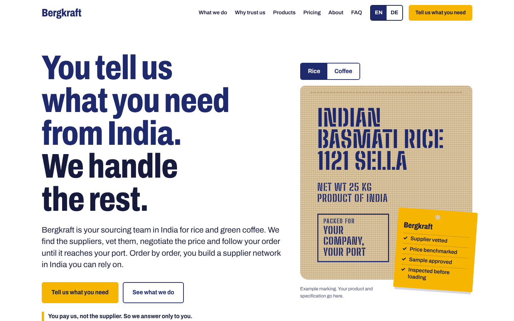

<h1 align="center">Bergkraft</h1>

<p align="center">
  Website for <strong>Bergkraft Private Limited</strong>, a sourcing team in India for international buyers of rice and green coffee.
</p>

<p align="center">
  <a href="https://bergkraftexports.com">bergkraftexports.com</a>
</p>

<p align="center">
  
  
  
  
</p>



## Contents

- [About](#about)
- [Tech stack](#tech-stack)
- [Quick start](#quick-start)
- [Scripts](#scripts)
- [Project structure](#project-structure)
- [Languages](#languages)
- [Editing content](#editing-content)
- [Design system](#design-system)
- [Enquiry form](#enquiry-form)
- [Analytics and consent](#analytics-and-consent)
- [SEO and structured data](#seo-and-structured-data)
- [Accessibility and performance](#accessibility-and-performance)
- [Deployment](#deployment)
- [Images](#images)
- [Pre-launch checklist](#pre-launch-checklist)
- [Testing status](#testing-status)
- [Content rules](#content-rules)
- [Maintenance](#maintenance)
- [Licence](#licence)

## About

Bergkraft works for international buyers who want to source agricultural products from India without building their own procurement team there. The site's message is simple: tell us what you need, and we find the suppliers, vet them, negotiate the price and follow the order to your port. The buyer engages and pays Bergkraft, and generally contracts directly with the supplier for the goods.

| Page | Path | Purpose |
| --- | --- | --- |
| Homepage | `/` | Promise, four-step service, trust, products, pricing, about, FAQ, enquiry form |
| Impressum | `/impressum/` | Legal notice |
| Privacy policy | `/datenschutz/` | GDPR privacy policy |
| Cookie policy | `/cookies/` | Cookies and browser storage |
| Thank you | `/thank-you/` | Shown after a form submission without JavaScript |
| 404 | `/404` | Not-found page |

Every page except the 404 also exists in German under `/de/`.

## Tech stack

| Area | Choice |
| --- | --- |
| Framework | [Astro](https://astro.build) with static site generation |
| Language | TypeScript (strict) |
| Styling | Plain CSS with design tokens (CSS variables), scoped per component |
| Interactivity | One small TypeScript file, no UI framework |
| Fonts | Archivo (text and headlines) and Big Shoulders Stencil (bag markings), self-hosted through Fontsource |
| Hosting | Netlify |
| Forms | Netlify Forms with a honeypot field |
| Analytics | Google Analytics 4, loaded only after consent |

There is no backend, database or client-side framework.

## Quick start

Requires [Node.js](https://nodejs.org) 22 or newer.

```bash
git clone https://github.com/dheerajsuvarna/bergkraft-website.git
cd bergkraft-website
npm install
npm run dev
```

Open http://localhost:4321. Press `Ctrl+C` to stop the server.

The enquiry form cannot submit locally. Netlify Forms only works on a Netlify deploy, so a local submission shows the form's error message.

## Scripts

| Command | Description |
| --- | --- |
| `npm run dev` | Start the development server with live reload |
| `npm run build` | Type-check, then build the production site into `dist/` |
| `npm run preview` | Serve the production build locally |
| `npm run check` | Type-check only |
| `npm run og` | Regenerate the social sharing image |

## Project structure

```
.
├── docs/                   README assets
├── public/                 Files served as they are
│   ├── images/             Social sharing image (and photos, once added)
│   ├── favicon.svg
│   ├── robots.txt
│   └── sitemap.xml
├── src/
│   ├── components/         One component per homepage section, plus shared parts
│   ├── data/
│   │   └── site.ts         Business facts and contacts, shared by both languages
│   ├── i18n/
│   │   ├── en.ts           All English text
│   │   ├── de.ts           All German text (same shape as en.ts)
│   │   └── index.ts        Language helpers
│   ├── layouts/
│   │   ├── BaseLayout.astro    Head, metadata, header, footer, consent banner
│   │   └── LegalLayout.astro   Wrapper for the legal pages
│   ├── pages/              Routes: English at the top level, German in pages/de/
│   ├── views/              Page bodies shared by both languages
│   ├── scripts/
│   │   └── interactions.ts Menu, bag tabs, form, consent, event tracking, language cookie
│   └── styles/
│       └── global.css      Design tokens, base styles, utilities
├── tools/
│   └── generate-og-image.mjs
├── astro.config.mjs
├── netlify.toml            Build settings and security headers
├── package.json
└── tsconfig.json
```

Homepage sections, in order:

| Component | Section |
| --- | --- |
| `Hero.astro` | Headline, calls to action and the example bag marking (`BagLabel.astro`) |
| `Steps.astro` | The service in four steps: Find, Vet, Negotiate, Deliver |
| `Trust.astro` | "You pay us, not the supplier" and four commitments |
| `Products.astro` | Rice and green coffee sourcing categories |
| `Price.astro` | How the price benchmark works, illustrative example, fee model |
| `About.astro` | Berlin and Mangalore, founder statement |
| `FAQ.astro` | Accordion |
| `ContactForm.astro` | Enquiry form |

Shared parts: `Header`, `Footer`, `LangSwitch`, `ConsentBanner`, `Verify` (marks unverified legal details).

## Languages

The site is in English and German.

| | English | German |
| --- | --- | --- |
| URL | `/` | `/de/` |
| Text | `src/i18n/en.ts` | `src/i18n/de.ts` |
| Audience | Global | Germany, Austria, Switzerland |

How a visitor gets a language:

- English is the default for everyone.
- A visitor from Germany, Austria or Switzerland who opens the homepage is redirected to `/de/`. This is a rule in `netlify.toml` based on the visitor's country, so it only works on Netlify, not on the local dev server.
- The EN / DE switcher in the header and footer works everywhere. If a visitor in those three countries picks English, a cookie (`bk_lang_en`) keeps them on the English homepage.
- Only the homepage is redirected. Every page has `hreflang` tags so search engines index both versions.

The two versions are not word-for-word copies. The English "About" section is written for a global audience; the German one stresses being close to the buyer in Europe.

Adding or changing text: edit the same key in both `en.ts` and `de.ts`. If a key is missing in `de.ts`, `npm run build` fails with a type error that names it. The legal pages are separate files per language (`src/pages/impressum.astro` and `src/pages/de/impressum.astro`, and so on).

## Editing content

| To change | Edit |
| --- | --- |
| Any visible text, navigation labels, FAQ, form labels, page titles | `src/i18n/en.ts` and `src/i18n/de.ts` |
| Email, phone numbers, LinkedIn URLs, founder photo, GA4 ID | `src/data/site.ts` |
| Illustrative benchmark figures | The `ex` object in `src/components/Price.astro` (totals are calculated) |
| Legal page text | `src/pages/` (English) and `src/pages/de/` (German) |
| A new page | Add it in `src/pages/` and `src/pages/de/`, then list both in `public/sitemap.xml` |

LinkedIn URLs and the founder photo are optional. While empty in `site.ts`, they are not shown.

## Design system

The look is taken from the trade: white, the indigo ink used to stencil export sacks, marigold yellow and jute. All tokens are CSS variables at the top of `src/styles/global.css`.

| Token group | Examples |
| --- | --- |
| Colour | `--c-indigo` `#1f2a6d`, `--c-indigo-deep` `#141b4a`, `--c-marigold` `#f6b500`, `--c-jute` `#dcc7a3`, `--c-tint` `#f2f4fa`, `--c-white` |
| Type | `--f-body` (Archivo) for everything, `--f-stencil` (Big Shoulders Stencil) for bag markings only; fluid sizes `--t-h1` to `--t-xs` |
| Spacing | `--s-1` to `--s-8`, plus `--s-section` for section padding |
| Layout | 12-column grid (`.grid`), `--max` content width, `--gutter`, `--radius` |

Conventions:

- Headlines are heavy and condensed (`font-weight: 800`, `font-stretch: 75%`), in sentence case and one colour.
- Marigold is the only bright colour. It marks the main button, the ticks and the step numbers.
- The stencil typeface appears only where it imitates a real bag marking.
- Section backgrounds are `section--indigo`, `section--tint` or `section--jute`. Indigo sections also take `on-dark`.
- Motion is limited to things the visitor triggers: the menu, the rice and coffee switch, and the FAQ.

## Enquiry form

The form in `ContactForm.astro` uses [Netlify Forms](https://docs.netlify.com/manage/forms/setup/).

- `data-netlify="true"` lets Netlify detect the form in the built HTML at deploy time.
- `netlify-honeypot="bot-field"` adds spam protection without a third-party CAPTCHA.
- With JavaScript, the form validates in the browser, submits in the background and shows a success or error message.
- Without JavaScript, it posts normally and redirects to `/thank-you/`.
- The privacy checkbox is required and never pre-ticked.

Form name in Netlify: `sourcing-enquiry`.

## Analytics and consent

- Google Analytics 4 (`G-VB6WR8LTBC`) is not loaded until the visitor selects Accept.
- Accept and Decline have identical styling.
- The choice is stored in the browser's local storage under `bk-analytics-consent`.
- "Cookie settings" in the footer reopens the panel. Declining after accepting disables analytics and removes its cookies.
- Visitors who decline are not counted, so GA4 figures are lower than real traffic.

Besides page views, the site sends these events (only after consent). Every event carries a `language` parameter (`en` or `de`).

| Event | When | Parameters |
| --- | --- | --- |
| `generate_lead` | The enquiry form is sent successfully | `product` |
| `cta_click` | A main "Tell us what you need" button is clicked | `location` (`hero`, `header`) |
| `contact_click` | An email or WhatsApp link is clicked | `method` (`email`, `whatsapp`) |
| `faq_open` | An FAQ question is opened | `question` (its position, 1 to 8) |
| `language_switch` | The language switcher is used | `to` |
| `outbound_click` | A LinkedIn link is clicked | `target` |

Set-up to do once in the Google Analytics interface:

1. Admin, Events: mark `generate_lead` and `contact_click` as key events.
2. Admin, Custom definitions: register `language`, `product`, `method`, `location` and `question` as event-scoped custom dimensions, so they can be used in reports.
3. Admin, Data retention: set event data retention to 14 months.
4. Admin, Product links: link Google Search Console, which shows the search terms people used to find the site.
5. Reports, Acquisition, Traffic acquisition: shows where visitors come from (search, direct, referral, social).
6. Use UTM parameters on links you share (for example `?utm_source=linkedin&utm_medium=social&utm_campaign=launch`) so campaigns show up by name.

The logic is in `src/scripts/interactions.ts`.

## SEO and structured data

- Title, meta description, canonical URL, Open Graph and Twitter metadata are set in `BaseLayout.astro`.
- Each page lists its English and German versions with `hreflang` tags, and `sitemap.xml` does the same.
- JSON-LD for `Organization`, `WebSite`, `Service` and `FAQPage` is generated in `src/views/Home.astro`, in the language of the page. The FAQ data comes from the language files, so visible content and structured data stay identical.
- `robots.txt` and `sitemap.xml` are in `public/`.
- No address, reviews or ratings are included in structured data because none are published on the site.

## Accessibility and performance

- Semantic HTML with one `h1` per page and a logical heading order.
- Skip link, visible focus states, keyboard-accessible menu and native `<details>` accordion.
- Labelled form fields with inline error messages linked through `aria-describedby`.
- `prefers-reduced-motion` is respected.
- Static HTML, about 5 KB of JavaScript, self-hosted fonts and no photographs to download: the hero graphic is drawn in CSS.

## Deployment

The site deploys to Netlify from the `main` branch. Settings are read from `netlify.toml`.

| Setting | Value |
| --- | --- |
| Base directory | (empty) |
| Build command | `npm run build` |
| Publish directory | `dist` |
| Node version | 22 |

First-time setup:

1. In Netlify, choose **Add new site**, then **Import an existing project**, and select this repository.
2. Confirm the settings above and deploy.
3. Under **Forms**, check that `sourcing-enquiry` was detected. Enable form detection if asked, then redeploy.
4. Under **Forms**, add an email notification to `contact@bergkraftexports.com`.
5. Send one test enquiry from the live site and confirm it arrives.
6. Under **Domain management**, add `bergkraftexports.com`.

After setup, every push to `main` triggers a new deploy.

## Images

The site currently uses no photographs. The hero graphic is drawn in CSS and labelled as an example marking.

- **Founder photo:** add a portrait (4:5) to `public/images/` and set `founderPhoto` in `src/data/site.ts`.
- **Social sharing image:** `public/images/og-image.png`, regenerated with `npm run og`.
- If photographs are added later, use only images Bergkraft owns or has licensed, and do not present stock images as Bergkraft facilities, suppliers or shipments.

## Pre-launch checklist

Legal pages (search the code for `<Verify` to find each item):

- [ ] Registered office address, CIN and directors
- [ ] IEC `AAOCB0571C` checked against the original certificate
- [ ] GSTIN and any German or EU VAT ID, if they are to be published
- [ ] Whether an EU representative under Art. 27 GDPR is required
- [ ] Data processing agreements with Netlify and Google
- [ ] Transfer safeguards for data sent to the USA and India
- [ ] Retention period for enquiries
- [ ] Competent supervisory authority
- [ ] Legal review of Impressum, privacy policy and cookie policy
- [ ] Set `legalPagesReviewed: true` in `src/data/site.ts` to remove the draft notice

Content:

- [ ] LinkedIn URLs for the company and the founder
- [ ] Both phone numbers, and that WhatsApp is active on them
- [ ] EUDR answer in `src/i18n/en.ts` and `de.ts` rechecked against the [European Commission page](https://environment.ec.europa.eu/topics/forests/deforestation/eu-deforestation-regulation-eudr_en)
- [ ] Rice varieties and coffee types listed in `Products.astro`
- [ ] Disclosure of any tie between Bergkraft and a supplier or farm network, wherever independence is claimed
- [ ] Founder photo added
- [ ] German text read by a native speaker; German legal pages reviewed by a lawyer
- [ ] Every statement in `Trust.astro` and `Steps.astro` matches how Bergkraft actually works

Technical:

- [ ] Test enquiry received through Netlify Forms
- [ ] GA4 receiving data and events after consent
- [ ] Region redirect checked on the live site: German homepage from DE, AT and CH; English elsewhere; English stays after choosing EN
- [ ] Lighthouse run on the deployed site

## Testing status

Checked locally against the production build in headless Chrome:

- Build and type-check pass with no errors
- No horizontal overflow at 360, 390, 768, 1024 and 1440 px
- Both languages build; navigation anchors resolve; the mobile menu, the rice and coffee switch and the language switcher work
- Form validation, success state (with a simulated server response) and error state
- No request to Google before consent or after declining; the GA4 script loads after accepting
- No browser console errors

Not yet tested, because it needs the live site or real accounts:

- The country-based redirect to German (it runs on Netlify's servers)
- Real Netlify Forms submissions, spam filtering and notifications
- GA4 data arriving in the property
- Lighthouse scores on the deployed site
- Screen-reader testing with assistive technology

## Content rules

This is a real business website. Everything published must be true and verifiable.

- No invented clients, testimonials, logos, shipment history, volumes, certifications or savings.
- No guarantees of savings, quality, delivery or regulatory compliance. Price claims describe the aim and the method ("the best price available for your specification"), never a guaranteed result.
- Figures in the benchmark example are always labelled as illustrative.
- No published fees, minimum quantities or response times unless confirmed.
- Bergkraft is described as a procurement services company, not as a trader, financier or exporter of record.

## Maintenance

- Check for updates every few months with `npm outdated`, and upgrade Astro with `npx @astrojs/upgrade`.
- Run `npm run build` and review the site after any dependency update.
- No secrets are needed or stored. The GA4 measurement ID is public by design.

## Licence

© Bergkraft Private Limited. All rights reserved.

The code and content in this repository are proprietary. They are not licensed for reuse without written permission.
